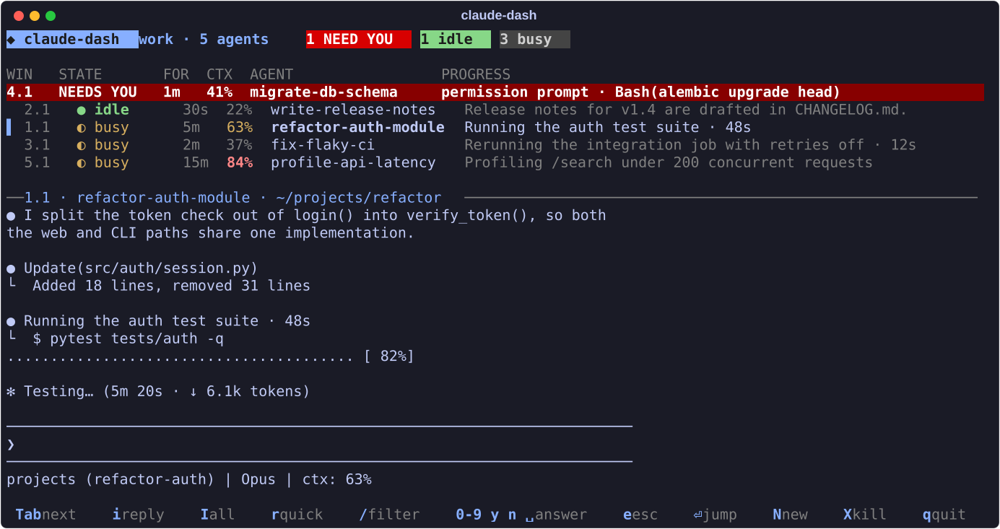
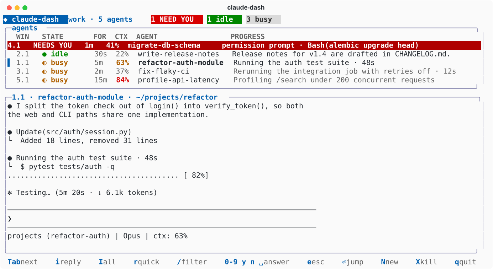

# claude-dash

A tmux dashboard for Claude Code. You run it in one pane, and it lists every Claude Code agent in the same tmux session. For each one it shows the live status, how long it has been in that state, its context use and its latest step. From the dashboard you can reply, answer prompts, jump to an agent, spawn one or kill one, so you never have to click through panes one at a time.



<details><summary>On a light terminal</summary>



</details>

An agent waiting on you gets a full-width red row, a red `N NEED YOU` badge appears in the header, and the terminal bell rings.

## Requirements

- tmux 3.2 or later (tested on 3.7b).
- Claude Code with `claude agents --json`, which needs 2.1.139 or later.
- Python 3.7 or later. The shebang is `/usr/bin/python3.11`; change it to match your system.
- Linux, because the dashboard maps agents to panes through `/proc`.

It has no Python dependencies and needs no Claude Code hooks.

## Install

1. Clone the repo:

   ```sh
   git clone https://github.com/mdmanurung/lucid-dashboard ~/lucid-dashboard
   ```

2. Point the shebang at a Python 3.7 or later. Skip this step if `/usr/bin/python3.11` exists. Otherwise check `python3 --version`, then run:

   ```sh
   sed -i "1s|.*|#!$(command -v python3)|" ~/lucid-dashboard/claude_dash.py
   ```

3. Put it on your `PATH` as `claude-dash`:

   ```sh
   mkdir -p ~/.local/bin
   ln -s ~/lucid-dashboard/claude_dash.py ~/.local/bin/claude-dash
   ```

4. Check that it runs and that Claude Code can list agents:

   ```sh
   claude-dash --help        # prints the keys
   claude agents --json      # prints a JSON list; needs Claude Code 2.1.139 or later
   ```

5. Add key bindings to `~/.tmux.conf`. `prefix A` opens the dashboard window and `prefix G` opens a popup:

   ```tmux
   bind A new-window -S -n dash ~/lucid-dashboard/claude_dash.py
   bind G run-shell 'tmux display-popup -c "#{client_name}" -E -w 90% -h 90% "$HOME/lucid-dashboard/claude_dash.py #{client_name}"'
   ```

   Pick other keys if `A` or `G` are taken; `tmux list-keys -T prefix` shows which ones are. Then reload:

   ```sh
   tmux source-file ~/.tmux.conf
   ```

6. Optional: add your own replies (see [Prefilled replies](#prefilled-replies)) and the status-bar theme (see [Status-bar badge and tmux theme](#status-bar-badge-and-tmux-theme)).

To update, run `git -C ~/lucid-dashboard pull`; if you edited the shebang, first run `git -C ~/lucid-dashboard checkout claude_dash.py`. To uninstall, delete `~/.local/bin/claude-dash`, the two bindings and the clone.

## Run

From inside the tmux session you want to watch:

```sh
tmux new-window -S -n dash /path/to/claude_dash.py
```

`-S` jumps to an existing `dash` window instead of opening a second dashboard. It also works as a split pane:

```sh
tmux split-window -h -l 45% /path/to/claude_dash.py
```

To open it as a popup, add this to `~/.tmux.conf`. The popup closes after `Enter` jumps to an agent.

```tmux
bind G run-shell 'tmux display-popup -c "#{client_name}" -E -w 90% -h 90% "/path/to/claude_dash.py #{client_name}"'
```

A popup has no pane of its own, so the binding passes the client name. `display-popup` does not expand `#{...}` formats but `run-shell` does, which is why the binding goes through `run-shell`.

## Keys

| Key | Action |
|---|---|
| `j` `k` / arrows | select an agent |
| `Tab` | select the next agent that needs you, waiting agents first, then idle ones |
| `Enter` | jump to the agent's pane |
| `i` | reply in the message box; `Alt-Enter` or a paste adds lines, `Enter` sends |
| `I` | message every listed agent; filter first to pick a group |
| `r` / `R` | prefilled reply to the selected / every listed agent: pick 1-9, edit it, `Enter` sends |
| `0`-`9` `y` `n` `Space` | answer a waiting prompt (`Space` sends Enter) |
| `e` | send Esc: interrupts a busy agent, cancels a waiting agent's dialog |
| `/` | filter by any words; `Enter` jumps to the top match, `Esc` clears |
| `N` | open a new Claude window in a directory you choose |
| `X` | kill the pane, after a `y/N` confirmation |
| `q` | quit |

The dashboard has safety rules for keys sent to agents:

- Prompt keys only go to agents shown as **waiting**, because a stray `1` would otherwise land in a busy agent's prompt.
- The same prompt key twice within 1.5 s is refused, because the next dialog may not be on screen yet.
- Messages only go to agents shown as **idle** or **busy**. A waiting agent would take `Enter` as "accept", and an unknown (`?`) one might be waiting.
- The selection follows the agent, not the row, so a re-sort can't send your key to a different agent. While a reply box is open, the arrow keys can't change the selection.
- The preview only ever shows the selected agent's screen.
- Alt+key, unknown escape sequences and pasted text never run as dashboard commands.

Statuses come from `claude agents --json` every 5 s, so a status can be up to about 6 s old. Check the preview before answering a dialog.

## Prefilled replies

Put your own replies in `~/.config/claude-dash/replies.txt`, one per line and at most 9. Lines starting with `#` are skipped.

```
# claude-dash replies
continue
run the tests and report what fails, with the exact error
stop and summarise where you are, what is done and what is left
```

The file is re-read every time you open the menu. Without it, the built-in `QUICK_REPLIES` in `claude_dash.py` are used.

## Light and dark terminals

The dashboard picks its light or dark palette from tmux's `#{client_theme}`. Set `CLAUDE_DASH_THEME=light` or `dark` to override it. Both palettes keep text contrast near or above 4.5:1. On an 8-colour terminal, the dashboard falls back to plain colours.

## Status-bar badge and tmux theme

While the dashboard runs, the session option `@claude_need` holds the number of waiting agents. Show it in any status line with:

```tmux
#{?@claude_need,#{@claude_need} NEED YOU,}
```

`tmux-modern.conf` is an optional theme that works on light and dark terminals and shows this as a red badge. It also adds pane-border labels with each agent's task name and rounded popups. To try it live, or to keep it, add this line to `~/.tmux.conf` above any TPM lines:

```sh
tmux source-file /path/to/tmux-modern.conf
```

## Where the data comes from

- **Status and name:** `claude agents --json`, polled every 5 s.
- **Time in state:** `statusUpdatedAt` in `~/.claude/sessions/<pid>.json`.
- **Agent to pane:** the parent-process chain in `/proc`, up to a tmux pane's pid.
- **Progress and context:** the agent's last `●` line and the `ctx: N%` in its status line, read with `tmux capture-pane`.

A background thread does every tmux read, so keypresses never wait on a subprocess. One frame draws in about 0.3 ms.

## Tests

```sh
python3.11 test_claude_dash.py   # pure functions: pane mapping, parsing, filter, message box, replies
bash stress_claude_dash.sh       # end to end in throwaway tmux sessions with fake agents
```

The stress test drives the dashboard against fake agents whose status it controls. It covers replies, broadcasts, prompt keys and the double-tap guard. It also checks that adversarial input (Alt+key, pastes into menus, broken escape sequences) runs nothing, that a pane with a newline in its path doesn't freeze the list, and that SIGTERM clears the badge. It never touches your other sessions.

## Limits

- `run-shell` cannot host the dashboard, because it has no tty.
- Without bracketed paste in your terminal, a pasted newline sends the message early.
- With two dashboards on one session, closing one clears the badge until the next status change.
- Agents inside `ssh` or `docker` in a pane are not listed: only local `claude` processes are.
- With two Claude processes in one pane, the outer (older) one's status is shown.
- The `CTX` column needs a status line that prints `ctx: N%`.
